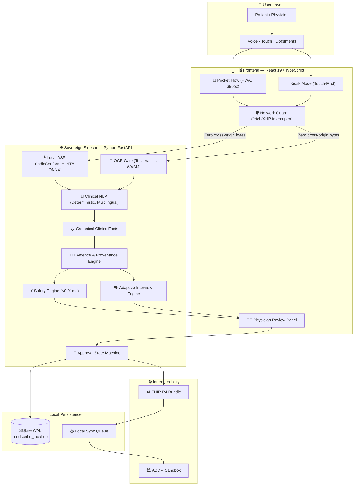

<div align="center">


# 🏥 Vaidhya Pocket

### *Sovereign, Offline-First Clinical AI Scribe — Designed for India's Frontlines*

[](LICENSE)
[](https://nodejs.org)
[](https://python.org)
[](https://react.dev)
[](https://fastapi.tiangolo.com)
[](https://tauri.app)
[](docs/BENCHMARKS.md)
[](docs/ARCHITECTURE.md)

> **iQOO Hackathon 2026 Grand Finale · Track: Open Innovation**  
> A phone-first clinical scribe that **cannot lie** — speech, text, and prescription photos become a SOAP draft entirely on-device. Every extracted fact must quote the patient's exact words, or it is withheld. **Zero bytes leave the device.**

</div>

---

## 📋 Table of Contents

- [✨ Demo](#-demo)
- [🧩 Architecture](#-architecture)
- [🚀 Key Features](#-key-features)
- [⚙️ Prerequisites](#️-prerequisites)
- [📦 Installation](#-installation)
- [▶️ Running the Application](#️-running-the-application)
- [🧪 Running Tests](#-running-tests)
- [📊 Validation Metrics](#-validation-metrics)
- [📁 Repository Structure](#-repository-structure)
- [🔒 Clinical Governance](#-clinical-governance)
- [📜 Declared Limitations](#-declared-limitations)
- [🗺️ Roadmap](#️-roadmap)
- [🤝 Contributing](#-contributing)
- [📄 License](#-license)

---

## ✨ Demo

> **Problem Statement:** SIH26047 — Patient Case-Taking Software (Theme: MedTech / BioTech / HealthTech | Team: AstraX)

### Live Demo Walkthrough

| Step | Clinical Action | Expected Result |
|------|----------------|-----------------|
| **1** | Start Patient Intake → enter `SYNTHETIC DEMO PATIENT` + ABHA ID | 14-digit format validation fires instantly |
| **2** | Type: *"Mujhe kal se seene me dard hai aur saans lene me takleef ho rahi hai."* | Extracts `chest_pain` + `dyspnea`, both `PRESENT / CURRENT`, with verbatim Hindi evidence anchors |
| **3** | Type: *"BP ka problem nahi hai lekin sar dard bahut rehta hai."* | `hypertension → NEGATED`, `headache → PRESENT` — negation never leaks |
| **4** | Observe top banner | 🚨 **Red-flag ACS alert fires** — no autonomous diagnosis, human action is required |
| **5** | Add allergy: `Penicillin` → medication: `Amoxicillin 500mg` | ⚠️ Beta-lactam cross-reactivity conflict flagged immediately |
| **6** | Click **Print Prescription** before approval | Button disabled: *"Physician Approval Required (AI Draft)"* |
| **7** | Click **Approve Documentation** | State: `AI_DRAFT → APPROVED` + immutable audit trail entry |
| **8** | Click **Export FHIR R4 Bundle** | Downloads valid FHIR R4 `Bundle` with `Patient`, `Encounter`, `Condition`, `Observation` resources |
| **9** | Enable Airplane Mode → repeat steps 2–8 | All features work — zero network dependency |

### Screenshots

<details>
<summary>📸 Click to expand — Application Screenshots</summary>

| | |
|---|---|
|  |  |
| *Patient Registration & ABHA Validation* | *Evidence-Grounded Clinical Facts* |
|  |  |
| *Deterministic Red-Flag Emergency Alert* | *Physician Review & Approval Panel* |
|  | |
| *FHIR R4 Bundle Export* | |

</details>

---

## 🧩 Architecture

Vaidhya Pocket employs a **fully sovereign, local-first** three-tier architecture: a **Tauri v2** native desktop shell (Rust), a **React 19** frontend, and an embedded **Python FastAPI** clinical sidecar — all communicating over local loopback with no cloud dependency.



### Component Summary

| Layer | Technology | Role |
|-------|-----------|------|
| **Native Shell** | Tauri v2 (Rust) | Desktop window management, sidecar lifecycle, scoped loopback IPC |
| **Frontend** | React 19, TypeScript 5.8, Vite 6 | Pocket PWA, Kiosk, Physician Review, Network Guard |
| **Clinical Sidecar** | Python 3.11 / FastAPI / Uvicorn | ASR, NLP, Safety Engine, Approval State Machine |
| **Speech Recognition** | ONNX Runtime, IndicConformer INT8 | On-device multilingual ASR (187.85 MB, CPU-only) |
| **OCR** | Tesseract.js WASM (bundled) | Prescription photo → structured text, no cloud call |
| **Persistence** | SQLite 3 (WAL, FK enabled) | Patient records, encounters, audit trail |
| **Styling** | Tailwind CSS v4 + Vanilla CSS tokens | Offline-capable, zero CDN dependency |

---

## 🚀 Key Features

### 🔒 Offline-First & Sovereign
- Operates in **full airplane mode** — no cloud API calls, no telemetry
- `NetworkGuard` intercepts every `fetch`, `XHR`, `beacon`, and `WebSocket` call and hard-blocks cross-origin traffic
- Byte counter displayed live in the **Device Proof Panel** (always shows 0 for outbound)

### 🧠 Zero-Hallucination Clinical NLP
- **100% evidence grounding** — every extracted clinical fact is anchored to the patient's verbatim words
- Supports **English, Hindi, Marathi, Gujarati, Tamil, Hinglish** with code-switching
- Precise **negation scope** (`"no fever"` never leaks into positive findings)
- Explicit **temporality** (`current` vs `historical`) and **experiencer** (`patient` vs `family`) classification

### ⚡ Deterministic Safety Engine
- **< 0.01 ms** red-flag triage for ACS, acute dyspnea, severe bleeding, and altered consciousness
- Offline **drug-drug conflict matrix** and beta-lactam cross-reactivity detection
- All safety alerts are advisory — MedScribeAI never auto-diagnoses

### 👨‍⚕️ Human-in-the-Loop Governance
- Strict `AI_DRAFT → REVIEWING → APPROVED` lifecycle
- Prescription printing and FHIR export are **physically gated** until physician approval
- Any post-approval edit **automatically reverts** to `REVIEWING`

### 📊 Standards Interoperability
- Exports validated **HL7 FHIR R4 Bundles** (`Patient`, `Encounter`, `Condition`, `Observation`, `MedicationStatement`)
- **ABHA 14-digit format** + Luhn checksum validation
- ABDM sandbox-ready foundations

### 📱 Phone-First PWA
- Installable Progressive Web App, optimised for **390px mobile screens**
- 6-step single flow, works fully in airplane mode
- Optional real in-browser LLM via **WebLLM (WebGPU)**

---

## ⚙️ Prerequisites

Ensure the following are installed on your system before proceeding:

| Dependency | Minimum Version | Recommended | Notes |
|-----------|-----------------|-------------|-------|
| **Node.js** | 18.0.0 | 20.x LTS | [nodejs.org](https://nodejs.org) |
| **npm** | 8.x | bundled with Node 20 | Comes with Node.js |
| **Python** | 3.11 | 3.12 | [python.org](https://python.org) |
| **Git** | 2.x | Latest | [git-scm.com](https://git-scm.com) |
| **Rust + Cargo** | 1.75.0 | Latest stable | **Optional** — only for native Tauri desktop build |
| **OS** | Windows 10 / macOS 12 / Ubuntu 22.04 | — | All platforms supported |

> **Note on Rust:** Only required if you want to compile the native Tauri binary (`npm run tauri dev`). The web development mode (`npm run dev`) works without Rust.

---

## 📦 Installation

### 1. Clone the Repository

```bash
git clone https://github.com/maitray-agrawal/vaidhya-pocket.git
cd vaidhya-pocket
```

### 2. Install Frontend Dependencies

```bash
npm install
```

### 3. Set Up Python Backend Environment

```bash
cd backend

# Create a virtual environment
python -m venv .venv

# Activate — Windows
.venv\Scripts\activate

# Activate — Linux / macOS
source .venv/bin/activate

# Install backend dependencies
pip install -r requirements.txt

# Return to project root
cd ..
```

### 4. Configure Environment Variables (Optional)

```bash
# Copy the example environment file
cp .env.example .env

# Edit as needed (all defaults work out of the box)
```

> **No API keys required.** The application runs entirely offline. Environment variables are optional and only used for advanced configuration.

---

## ▶️ Running the Application

### Option A — Web Dev Mode (⚡ Fastest, Recommended for Evaluation)

Starts the Vite React frontend with the integrated Express server:

```bash
npm run dev
```

Open **[http://localhost:3000](http://localhost:3000)** in your browser.

**URL Query Parameters:**
| Parameter | Effect |
|-----------|--------|
| *(default)* | Phone-first Pocket flow (390px) |
| `?full=1` | Legacy desktop workstation view |
| `?bench=1` | On-device benchmark page |
| `?llm=webllm` | Real in-browser LLM via WebGPU |
| `?webspeech=1` | Browser dictation via Web Speech API |

### Option B — Local Python Sidecar (Clinical Backend)

Run the FastAPI clinical service independently:

```bash
cd backend
python run_server.py
```

API docs available at **[http://127.0.0.1:8000/docs](http://127.0.0.1:8000/docs)** (Swagger UI).

### Option C — Native Desktop App (Tauri)

Spawns the full desktop application, automatically managing the Python sidecar:

```bash
npm run tauri dev
```

> **Requires Rust + Cargo** to be installed. The Tauri shell handles process lifecycle, window management, and scoped IPC.

---

## 🧪 Running Tests

### Frontend Unit & Integration Tests (Vitest)

```bash
npm test
# or verbose:
npm test -- --run
```

Runs **345 automated tests** covering unit logic, React components, and clinical integration scenarios.

### TypeScript Type Verification

```bash
npm run lint
```

Verifies zero type errors across the entire TypeScript codebase.

### Backend Test Suite (Pytest)

```bash
cd backend
pytest
```

Runs **89 automated tests** covering ASR contracts, NLP extraction, evidence gating, and SQLite persistence.

### Production Build Verification

```bash
npm run build
```

Compiles the production web assets and server bundle.

### Benchmark Harness

```bash
npm run bench
```

Runs the full validation suite and outputs results to `docs/BENCHMARKS.md`. Unmeasured values are explicitly marked `NOT MEASURED`.

---

## 📊 Validation Metrics

All metrics empirically measured on a reference Windows 11 workstation *(Intel Core Ultra 5 125H, 16 GB RAM)*.

### Clinical Extraction Performance — 150-Case Gold-Standard Corpus

| Metric | Score |
|--------|-------|
| **Overall Precision** | 99.39% (164 TP, 1 FP) |
| **Overall Recall** | 93.71% (164 TP, 11 FN) |
| **Overall F1-Score** | 96.47% |
| **Hindi F1-Score** | 94.44% (65 cases) |
| **Marathi F1-Score** | 100.0% (20 cases) |
| **English F1-Score** | 98.36% (25 cases) |
| **Evidence Grounding Rate** | **100.0%** (0 unanchored hallucinations / 166 facts) |
| **Assertion Classification** | 97.56% |
| **Temporality Accuracy** | 96.34% |
| **Experiencer Accuracy** | 98.17% |

> ⚠️ *Precision/Recall were measured in-sample on synthetic cases. See [`docs/BENCHMARKS.md`](docs/BENCHMARKS.md) for full honesty declarations.*

### Latency Profiles (n ≥ 30 samples each)

| Operation | Median | P95 |
|-----------|--------|-----|
| Clinical NLP Extraction | 0.24 ms | 0.49 ms |
| Language Identification | 0.01 ms | 0.01 ms |
| Safety Rule Evaluation | < 0.01 ms | < 0.01 ms |
| SQLite Write (Encounter + Facts) | 11.80 ms | 14.60 ms |
| SQLite Read | 0.12 ms | 0.21 ms |
| Approval Transition | 4.11 ms | 4.96 ms |
| ASR Inference (2.5s audio) | 93.64 ms | 104.09 ms |
| ASR Cold Start | 2,432.54 ms | — |

---

## 📁 Repository Structure

```
vaidhya-pocket/
├── backend/                        # Sovereign Python/FastAPI clinical sidecar
│   ├── app/
│   │   ├── api/routes/             # REST endpoints (health, ASR, OCR, clinical)
│   │   ├── asr/                    # Sovereign ASR engine (IndicConformer ONNX)
│   │   ├── clinical/               # ClinicalFact models & evidence gate
│   │   ├── core/                   # Config, logging, lifecycle
│   │   ├── nlp/                    # Deterministic multilingual clinical extractors
│   │   ├── ocr/                    # Document preprocessing & Tesseract pipeline
│   │   ├── safety/                 # Red-flag & drug conflict rules
│   │   └── storage/                # SQLite persistence & approval state machine
│   ├── tests/                      # Backend test suite (13 test files, 89 tests)
│   └── requirements.txt
├── docs/                           # Technical documentation & audit reports
│   ├── ARCHITECTURE.md
│   ├── BENCHMARKS.md
│   ├── CONTRIBUTING.md
│   ├── VALIDATION.md
│   └── ...
├── models/                         # Local ML model assets
│   └── asr/indic-conformer/        # INT8 ONNX speech model (187.85 MB, git-ignored)
├── src/                            # Frontend source code (React 19 / TypeScript)
│   ├── clinical/                   # Client-side ClinicalFact state
│   ├── components/                 # UI components (SOAP, Kiosk, Triage, Pocket)
│   ├── dictionaries/               # Multilingual clinical concept lexicons
│   ├── i18n/                       # Locales (EN, HI, MR, GU, TA)
│   ├── llm/                        # Local LLM adapter (WebLLM / rule-engine)
│   ├── nlp/                        # Code-switching & temporal normalizers
│   ├── ocr/                        # Tesseract.js WASM client-side OCR
│   ├── pocket/                     # Phone-first 6-step intake flow
│   ├── services/                   # Client adapters & IPC interfaces
│   ├── utils/                      # FHIR converter, drug checker, triage detector
│   └── __tests__/                  # Frontend test suite (24 files, 345 tests)
├── src-tauri/                      # Native desktop shell (Rust)
│   ├── src/main.rs                 # Sidecar lifecycle & window handlers
│   └── tauri.conf.json             # Tauri v2 configuration
├── Screenshots/                    # Application screenshots
├── validation/                     # SIH 2026 validation suite & audit artifacts
│   ├── datasets/                   # Synthetic clinical test corpora
│   ├── metrics/                    # Measured latency & accuracy benchmarks
│   └── reports/                    # Audit & traceability reports
├── DEMO.md                         # Step-by-step evaluator walkthrough
├── CHANGELOG.md                    # Semantic version history (v1.0.0–v2.0.0)
├── SECURITY.md                     # Vulnerability disclosure policy
├── LICENSE                         # MIT License
├── package.json                    # Node dependencies & scripts
├── server.ts                       # Integrated Node development server
└── vite.config.ts                  # Vite build configuration
```

---

## 🔒 Clinical Governance

Clinical documentation follows an **immutable, state-enforced lifecycle**:

```
[AI_DRAFT]
    │
    ▼  Physician opens encounter in review panel
[REVIEWING]
    │
    ▼  Physician verifies facts → clicks "Approve Documentation"
[APPROVED]
    │
    ├─► Material Edit Detected ──► Reverts to [REVIEWING] (Prior Approval Invalidated)
    │
    ▼  Clinician initiates export
[EXPORTED]
```

**Hard invariants enforced by the system:**
- 🚫 **Prescription Gate:** Printing is physically disabled in `AI_DRAFT` or `REVIEWING` state
- 🚫 **Export Gate:** FHIR serialization requires `state == 'APPROVED'`
- 🔄 **Edit Invalidation:** Post-approval modifications auto-revert to `REVIEWING`
- 🛑 **Fabrication Gate:** Facts with no verbatim evidence anchor are withheld entirely
- 🔒 **Consent Invariant:** If hospital sharing consent is revoked, outbound sync is permanently blocked

---

## 📜 Declared Limitations

In adherence to healthcare software engineering standards, Vaidhya Pocket transparently declares its current boundaries:

1. **Acoustic ASR Accuracy:** The INT8 ONNX engine is runtime-verified at < 100ms inference; Word Error Rate (WER) across diverse rural dialects against a live multi-speaker corpus has **not yet been benchmarked**.
2. **Host OCR:** Document upload pipeline cleanly reports `is_available: false` when Tesseract is absent; it never fabricates text.
3. **ABDM Status:** ABHA 14-digit + Luhn validation executes locally; live OTP verification runs against simulated sandbox endpoints pending NHA production credentials.
4. **Non-Diagnostic Scope:** Vaidhya Pocket is a clinical documentation assistant. It does **not** autonomously diagnose diseases or generate unprompted prescriptions.

---

## 🗺️ Roadmap

| Phase | Target | Description |
|-------|--------|-------------|
| **9.0** | Near-term | Bundle portable Tesseract binaries in the desktop distribution |
| **9.1** | Q1 2027 | Formal multi-accent ASR benchmarking against AI4Bharat Kathbath dataset |
| **9.2** | Q2 2027 | Production NHA ABDM M1, M2, M3 gateway connectors |
| **9.3** | Q3 2027 | Multi-center clinical usability & time-motion study in rural district health centres |

---

## 🤝 Contributing

Contributions must maintain **zero-fabrication invariants** and pass all quality gates.

See [CONTRIBUTING.md](docs/CONTRIBUTING.md) for full setup instructions, coding conventions, and pull request workflows.

---

## 🔐 Security & Privacy

Vaidhya Pocket implements a **defense-in-depth privacy model**. Protected Health Information (PHI) is never persisted in external stores or browser `localStorage`. For vulnerability disclosure and security policy details, see [SECURITY.md](SECURITY.md).

---

## 📄 License

This project is licensed under the **MIT License** — see the [LICENSE](LICENSE) file for details.

---

## 📚 References

1. Sinsky, C., et al. (2016). *Allocation of Physician Time in Ambulatory Practice.* Annals of Internal Medicine, 165(11), 753–760.
2. Tierney, A. A., et al. (2024). *Ambient AI Scribes to Alleviate Clinical Documentation Burden.* NEJM Catalyst, 5(3).
3. World Health Organization. (2021). *Ethics and Governance of AI for Health.* WHO, ISBN 978-92-4-002920-0.
4. National Health Authority, India. (2022). *Ayushman Bharat Digital Mission Architecture and Specifications.*

---

<div align="center">

**Built with ❤️ for India's Healthcare Frontlines**  
*Team AstraX · iQOO Hackathon 2026 · SIH26047*

</div>
